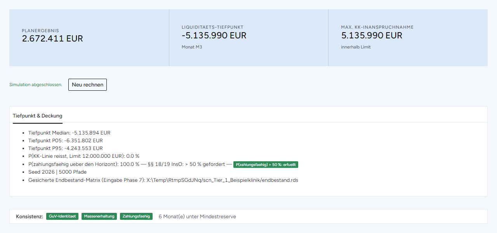
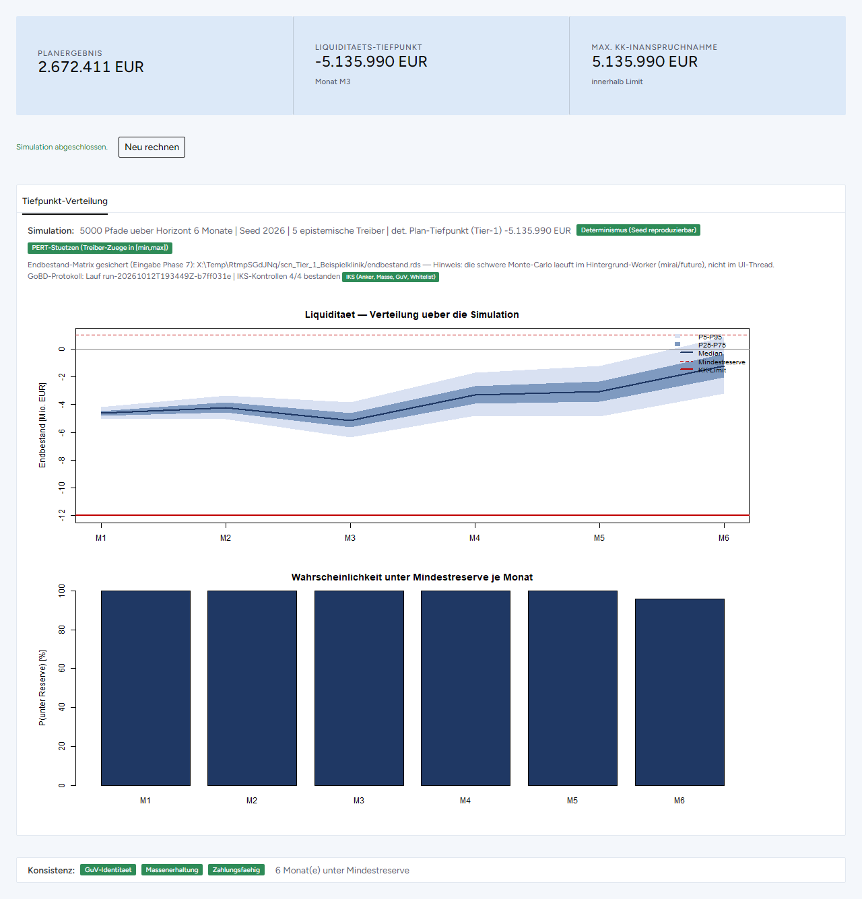
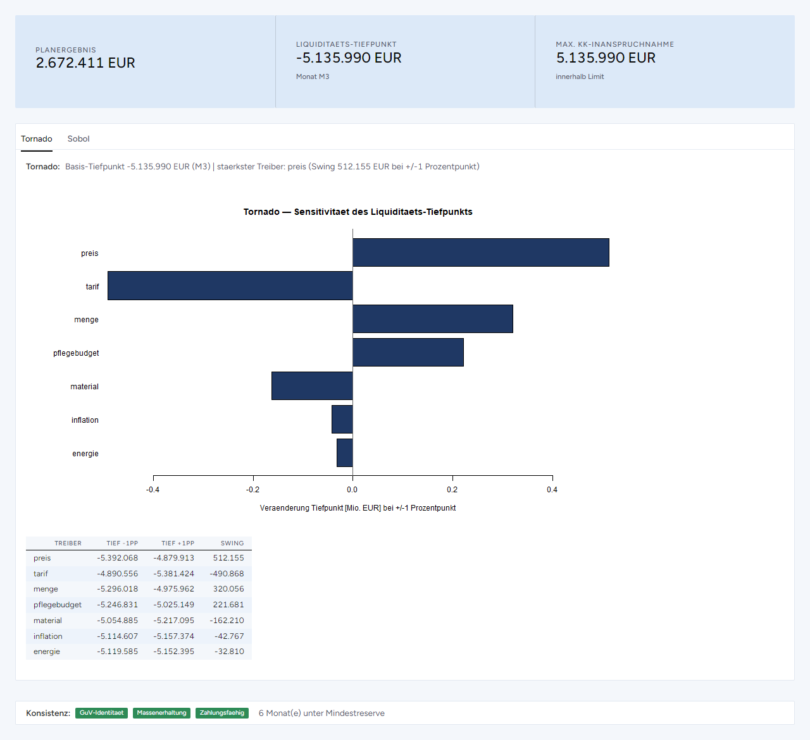
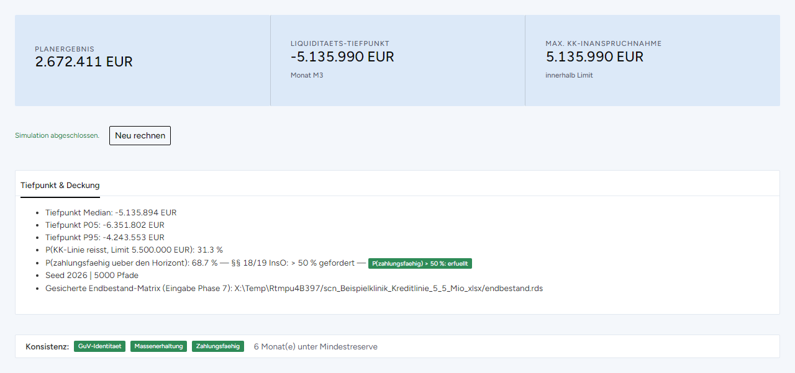

# Probabilistische Liquiditätsplanung mit Monte-Carlo-Simulation (R/Shiny)

[](https://doi.org/10.5281/zenodo.23352913)

**English summary.** A Monte Carlo layer around a deterministic monthly liquidity plan, plus a weekly view without simulation, reconciled to the monthly run. Instead of a single cash line, the tool reports the probability of staying solvent over the forecast horizon, the distribution of the cash trough, quantile bands of the month-end balance, the probability of falling below a minimum reserve in each month, and which assumptions drive the trough (tornado, Sobol indices). Epistemic uncertainty (unknown annual assumptions) and aleatoric variability (month-to-month noise estimated from history) are modelled separately, and the variance of the trough is split into both parts. The bundled example is a fictitious hospital. Interface and documentation are in German.

---

## Wozu

Sanierungs- und Insolvenzentscheidungen hängen an einer Frage über die Zukunft: Bleibt das Unternehmen über den Prognosezeitraum zahlungsfähig? Die Fortbestehensprognose nach § 19 InsO fragt nach einer *überwiegenden Wahrscheinlichkeit*, die übliche Praxis antwortet mit einer einzigen Planlinie und ein, zwei Szenarien. Ein Punktwert kann keine Wahrscheinlichkeit ausdrücken.

Die Anwendung ersetzt den deterministischen Plan nicht, sie legt eine stochastische Schicht darum. Unsichere Eingaben werden durch dieselbe buchhalterische Logik propagiert, die auch den Punktplan erzeugt. Ergebnis ist eine Verteilung möglicher Verläufe und daraus die Wahrscheinlichkeit, eine kritische Schwelle zu unterschreiten, etwa die Kontokorrentlinie oder eine Mindestreserve. Die Methode stammt aus der Pharmakometrie, wo dieselbe Problemform Standard ist: ein mechanistisches Modell, unsichere Parameter und die Frage, mit welcher Wahrscheinlichkeit eine Zielgröße in einem Korridor bleibt.

## Was die Anwendung rechnet

| Schritt | Inhalt |
|---|---|
| Forecast | deterministischer Monatsplan aus BWA-/GuV-Historie, Zahlungsprofilen, Annahmen, Finanzierungsplan, Steuern, Darlehen und offenen Posten; Validierung gegen die Historie (GuV-Identität, Cash-Massenerhaltung) |
| Wochen | Wochensicht über den Prognosezeitraum, aus dem Monatslauf abgeleitet und auf ihn rückabgestimmt (deterministisch) |
| Sensitivität | Tornado (jede Jahresannahme ±1 Prozentpunkt) und Sobol-Indizes erster Ordnung und total (Saltelli/Jansen): welche Annahmen den Liquiditätstiefpunkt treiben |
| Verteilungen | PERT-Verteilungen für die Jahresannahmen (epistemisch), Variationskoeffizienten der Monatsschwankung aus der Historie (aleatorisch) |
| Abhängigkeit | Korrelationsmatrix der Treiber mit Reparatur auf positive Semidefinitheit, Validierung der Gauß-Copula |
| Simulation | genestete Monte-Carlo-Simulation (Beispielrechnung: 5.000 Pfade): Verteilung des Tiefpunkts, Endbestand je Monat mit Quantilbändern, Wahrscheinlichkeit unter der Mindestreserve je Monat, Wahrscheinlichkeit, die Kontokorrentlinie zu reißen bzw. über den Horizont zahlungsfähig zu bleiben |
| Varianzzerlegung | Zerlegung der Streuung des Tiefpunkts in den epistemischen und den aleatorischen Anteil |
| Szenarien und Maßnahmen | Szenario-Vergleich; Maßnahmenkatalog mit Paketen, Delta-Vorschau und Vergleich Basis gegen Basis plus Paket |
| Export und Nachvollziehbarkeit | Excel, Word und PDF, GoBD-Datenträgerüberlassung (Z3: CSV und `index.xml`) und Verfahrensdokumentation; je Simulationslauf ein SHA-256-Manifest mit Eingabekopie und Kontrollen; eine Herkunftstabelle bindet die drei Kopfzahlen eines Exports an Lauf und Manifest. Ein hash-verkettetes Verfahrensprotokoll und die Finalisierung von Läufen liegen als getestete Funktionen in `R/` vor, sind in der Oberfläche aber noch nicht angebunden. |

Die Methodik ist in [`docs/Methodendokumentation_Liquiditaetsmodell.md`](docs/Methodendokumentation_Liquiditaetsmodell.md) beschrieben, die Wahl der PERT-Verteilung in [`docs/Methodik_Treiberverteilung_PERT.md`](docs/Methodik_Treiberverteilung_PERT.md), der fachliche Hintergrund in [`docs/Motivation_und_Hintergrund_Liquiditaetsmodell.md`](docs/Motivation_und_Hintergrund_Liquiditaetsmodell.md).

## Ansicht

Aufnahmen der laufenden App, Stand 12.10.2026: die ersten drei mit der fiktiven Beispielklinik (Knopf „Demo laden (Tier-1)"), die vierte mit einem Szenario.

**Tiefpunkt und Deckung:** Quantile des Liquiditätstiefpunkts, Wahrscheinlichkeit, die Kontokorrentlinie zu reißen, und Wahrscheinlichkeit, über den Horizont zahlungsfähig zu bleiben.



**Endbestand je Monat:** Monte-Carlo-Bänder (P5–P95, P25–P75, Median) mit Mindestreserve und Kontokorrentlinie, darunter die Wahrscheinlichkeit, im jeweiligen Monat unter der Mindestreserve zu liegen.



**Treiberanalyse:** Wirkung von ±1 Prozentpunkt je Jahresannahme auf den Tiefpunkt; die Sobol-Indizes stehen im zweiten Reiter.



**Szenario „Kontokorrentlinie 5,5 Mio. €":** Der Punktplan bleibt innerhalb der Linie (größte Inanspruchnahme 5.135.990 €), die Wahrscheinlichkeit der Zahlungsfähigkeit über den Horizont liegt aber nur bei 68,7 %.



Geändert ist gegenüber der Beispielmappe nur ein Wert: Blatt `03_Stammdaten_Eroeffnung`, Schlüssel `kk_limit` (Zelle B10, Kontokorrentlinie), 12.000.000 → 5.500.000 €; Annahmen und alle übrigen Werte sind unverändert. Zum Nachstellen diesen Wert in einer Kopie von `fixtures/Mandant_Liquiditaetsmodell_Vorlage.xlsx` ändern, die Kopie in der Seitenleiste unter „oder eigene Mappe" laden und „Tiefpunkt & Deckung" öffnen; die Kopie liegt nicht im Repository. Die App rechnet die Monte-Carlo-Simulation im Hintergrundprozess (mirai) mit dem Zufallsgenerator L'Ecuyer-CMRG; ein direkter Aufruf von `phase_simulation()` in R nutzt bei gleichem Seed den Standardgenerator Mersenne-Twister und kommt deshalb auf leicht andere Werte, hier 68,6 % statt 68,7 % (1570 statt 1564 von 5000 Pfaden reißen die Linie).

## Aufbau

```
kernel/    Rechen-Engine (engine.R, distributions.R), ohne Mandantenzahlen und ohne Oberfläche
R/         Phasenfunktionen, Szenarien, Export, Protokoll und Manifeste
app/       Shiny-Oberfläche (bslib); rechnet nur über R/, vom Kernel nutzt sie allein die Zahlenformatierung
fixtures/  Eingabemappe mit fiktiver Beispielklinik und leere Vorlage für neue Mandate
legacy/    ursprüngliche Phasenskripte für die Kommandozeile und die Python-Generatoren der beiden Mappen
tests/     Golden-Master gegen eingefrorene Referenzwerte und testthat-Suite
docs/      Methodendokumentation, Anleitung für neue Mandate, Bildschirmfotos (docs/img/)
handoff/   Phasenverträge aus der Entwicklung (siehe „Entwicklungsartefakte")
```

Schnittstellen der Engine, Phasenabhängigkeiten und Cache-Regeln beschreibt der Architekturentwurf [`ARCHITECTURE.md`](ARCHITECTURE.md).

Die sieben R-Skripte in `legacy/` sind die Kommandozeilen-Vorlagen, aus denen die Phasenfunktionen in `R/` entstanden. Sie laufen aus der Repo-Wurzel, etwa `Rscript legacy/01_forecast.R` (ohne Argument mit der Beispielmappe, sonst mit dem übergebenen Pfad), und schreiben Grafiken und Zwischenergebnisse nach `out/`; `03` und `04` erzeugen die Eingaben für `05` und `05b`, `04` nutzt `Matrix::nearPD`, falls das Paket vorhanden ist. Von den Python-Generatoren erzeugt `build_workbook.py` die Beispielmappe `fixtures/Mandant_Liquiditaetsmodell_Vorlage.xlsx`; er ist nicht nach R portiert und wird für App und Tests nicht gebraucht. `build_workbook_neuer_mandant.py` ist durch `R/new_mandate.R` ersetzt: Die App bietet die leere Mappe als Download an, und `tests/test_new_mandate.R` vergleicht sie Zelle für Zelle mit der Python-Ausgabe `fixtures/Mandant_NEU.xlsx`.

## Installation und Start

Voraussetzung ist R (geprüft mit 4.5.3) mit diesen Paketen:

```r
install.packages(c("shiny", "bslib", "readxl", "openxlsx2", "mirai", "promises",
                   "digest", "jsonlite", "officer", "quarto"))
```

Für den PDF-Export zusätzlich die [Quarto-CLI](https://quarto.org). Start aus dem Wurzelverzeichnis:

```r
shiny::runApp("app")
```

Die Beispielmappe `fixtures/Mandant_Liquiditaetsmodell_Vorlage.xlsx` lädt der Knopf „Demo laden (Tier-1)". Für eigene Daten beschreibt [`docs/Anleitung_neuer_Mandant.md`](docs/Anleitung_neuer_Mandant.md), wie die leere Mappe `fixtures/Mandant_NEU.xlsx` befüllt wird; dieselbe Mappe liefert die App unter „Datei -> Neues Mandat". Jeder Simulationslauf in der App legt unter `runs/` ein Verzeichnis mit Eingabekopie, Endbestand-Matrix und Manifest an (in `.gitignore` ausgeschlossen).

## Tests

```
Rscript tests/deps.R      # fehlende Pakete installieren (testthat, shinytest2, chromote, pdftools …)
Rscript tests/run_all.R   # Golden-Master und testthat-Suite
```

Die Tests prüfen die **Rechenrichtigkeit**: Engine-Ergebnisse auf der Beispielklinik gegen eingefrorene Referenzwerte, GuV-Identität und Cash-Massenerhaltung, Invarianten der Verteilungs- und Simulationsschicht, Exporte und Manifeste sowie die Oberfläche (shinytest2, benötigt Chrome oder Chromium). Sie prüfen **nicht die Prognosegüte**; eine Kalibrierung der Wahrscheinlichkeiten an späteren Verläufen steht aus.

## Teststand

12.10.2026 · Windows 11 x64 (Build 26200) · R 4.5.3 (2026-03-11 ucrt) · Quarto-CLI 1.9.38 · Chrome 155

`Rscript tests/run_all.R` meldet:

- **Tier-1 gehalten:** Historie −5.235.600, Tiefpunkt −5.135.990 in M3, Planergebnis 2.672.411, jeweils gleich dem eingefrorenen Referenzwert; GuV-Konsistenz und Massenerhaltung OK.
- **testthat:** 85 Testdateien, davon 7 ohne `test_that`; 413 Tests, davon 412 bestanden, 1 übersprungen, 0 fehlgeschlagen (2.441 erfüllte Erwartungen, 0 Warnungen). Die Browser-Tests (shinytest2) liefen mit Chrome.
- **Übersprungen** (testthat listet acht Einträge):
  - 7 × „empty test": Die Dateien `tests/test_*_gc_seam.R` enthalten absichtlich kein `test_that`; sie geben zwischen speicherintensiven Testblöcken Arbeitsspeicher frei (`gc()`).
  - 1 × Browser-Test des Maßnahmen-Schirms (`tests/test_massnahmen_ui.R`): absichtlicher Skip mit Begründung im Test. Reiterklick, Auslesen der Vorschau im Browser und Hintergrundlauf sind nicht als Browser-Test umgesetzt; Bindung und Rechenvorschrift der Vorschau prüfen die übrigen Tests der Datei ohne Browser.

Laufzeit einschließlich `tests/deps.R` knapp drei Minuten.

## Entstehung

Der Code ist mit agentengestützter Codeerzeugung entstanden, in einer Multi-Agenten-Umgebung, in der Sprachmodelle planen, implementieren, gegenseitig prüfen und Mutationstests bestehen müssen; Änderungen an den Vorgaben laufen über eine menschliche Freigabe. Eigener Anteil: fachliche Spezifikation, Methodik der Engine und der Verteilungsschicht, Architektur, Referenzfälle sowie Prüfung und Freigabe jeder Phase.

## Entwicklungsartefakte

Vier Teile der Entwicklungsumgebung liegen bei, weil sie die Spezifikation sind, gegen die gebaut und geprüft wurde; die Kommentare in `R/`, `app/` und `tests/` verweisen auf sie.

| Teil | Inhalt |
|---|---|
| [`CLAUDE.md`](CLAUDE.md) | Arbeitsanweisung an die Coding-Agenten: unverrückbare Regeln (Kernel schreibgeschützt, Tier-1-Anker, Mappe als Engine-Vertrag), Bauschema einer Phase, Definition of Done (`Rscript tests/run_all.R`) |
| [`IMPLEMENTATION_RULES.md`](IMPLEMENTATION_RULES.md) | verbindliche Schwellen und Invarianten zu Korrektheit, Determinismus, Nebenläufigkeit und Tests sowie offen zu benennende Grenzen; ein Verstoß ist ein Critical-Befund im Review |
| [`CAPABILITY_MAP.md`](CAPABILITY_MAP.md) | Bauplan und Abnahmeliste: Engine-Funktion → Wrapper in `R/` → Bedienelement in `app/` → Test; geführt bis Phase 12 |
| [`handoff/`](handoff/) | je Arbeitseinheit ein maschinenlesbarer Phasenvertrag (`phase-*.json`, Schema `phase_handoff.schema.json`): Zweck, Funktionen und Zieldateien, Tests mit Prüfausdruck, DOM-Kennzahlen, Anker-Zusage |

Begriffe in den Code-Kommentaren:

| Begriff | Bedeutung |
|---|---|
| Builder | Sprachmodell-Agent, der eine Phase umsetzt: in Runde T die Spezifikationstests, in Runde I die Implementierung |
| Reviewer | ein Modell eines anderen Anbieters prüft den Diff jeder Phase gegen `IMPLEMENTATION_RULES.md`; jeder Befund mit Schweregrad und Fundstelle |
| Red-Team | ein weiteres Modell sucht gezielt Stellen, an denen ein Kandidat nur grün aussieht: hartcodierte Anker, Tests, die nicht fehlschlagen können, umgangene Gates, Eingriffe in den Kernel; jeder belegte Befund und jedes „UNVERIFIED" blockiert |
| Mutationstest-Gate „Mutgate" | nach dem Implementierungs-Commit werden fünf gezielte Fehler (Mutanten) in den neuen Code eingebaut; erkennt die Suite weniger als vier, ist das Gate rot; überlebende Mutanten führen zu nachgeschobenen Tests (`tests/*_mutgate*.R`) |
| Rot-zuerst | Spezifikationstests werden vor der Implementierung festgeschrieben und müssen gegen den alten Stand fehlschlagen; danach bleiben sie unverändert |
| Tier-1-Anker | die drei Kopfzahlen der Beispielklinik (Historie −5.235.600 EUR, Tiefpunkt −5.135.990 EUR in M3, Planergebnis 2.672.411 EUR), eingefroren in `tests/tier1_baseline.R`; keine Phase durfte sie verändern |
| Phasenvertrag | die Datei `handoff/phase-*.json` einer Arbeitseinheit, vor dem Bau vom Planner-Agenten erstellt; Tests und Kommentare zitieren daraus |
| Gate A, Betreiber-Freigabe | Gate A: Anker-Prüfung und Testsuite vor der Abnahme einer Runde; Betreiber-Freigabe: menschliche Freigabe einer Änderung an den Vorgaben oder einer Ausnahme |
| Orakel | Erwartungswert eines Tests, der unabhängig vom geprüften Code berechnet ist |
| `.orch/` | Arbeitsablage des Orchestrators mit Review-Befunden und Mutanten-Archiven |

Orchestrator, Rollenprompts, Prüfskripte und Arbeitsablage (`orchestrate.sh`, `prompts/`, `scripts/`, `.orch/`, `PROGRESS.md`) gehören zur Entwicklungsumgebung und liegen nicht in diesem Repository. Die Umgebung, in der der Code entstand, ist in verallgemeinerter Fassung als [harness-template](https://github.com/DanielMoj/harness-template) veröffentlicht. Elf Phasenverträge mit einem zweiten Bindestrich im Namen (etwa `phase-12-protokoll-hash`) verletzen das Namensmuster ihres Schemas; der Vertrag `phase-12-runmanifest-anbindung` vermerkt das als bekannten, nicht blockierenden Formbefund.

## Grenzen

Die Anwendung erzeugt keine Sicherheit, sie macht vorhandene Unsicherheit ausdrücklich. Die ausgewiesenen Wahrscheinlichkeiten sind bedingt auf das Modell und die angenommenen Bandbreiten; die Ergebnisse sind nur so gut wie die Eingaben. Steuern sind näherungsweise modelliert, nicht veranlagungsgenau. Die Sobol-Indizes werden mit N = 800 geschätzt; dabei kann der Haupteffekt über dem Totaleffekt liegen, weil beide Schätzer dieselbe geschätzte Varianz des Tiefpunkts teilen und so gemeinsames Monte-Carlo-Rauschen tragen (`tests/test_sobol_invarianten.R` misst an der Beispielklinik bis zu 0,067 und lässt Abweichungen bis 4/√N zu); ein größeres N setzt das Argument `sobol_N` von `phase_sensitivitaet()` in `R/phase_sensitivitaet.R`. Die Anwendung ist ein Prototyp und Entscheidungsunterstützung, kein Ersatz für eine fachliche Fortbestehensprognose.

## Zitieren

Bitte über die DOI der jeweiligen Version zitieren (Zenodo); die Angaben stehen in [`CITATION.cff`](CITATION.cff).

- Version 1.0.0: [10.5281/zenodo.23352914](https://doi.org/10.5281/zenodo.23352914)
- alle Versionen (Konzept-DOI, führt stets zur neuesten Version): [10.5281/zenodo.23352913](https://doi.org/10.5281/zenodo.23352913)

## Lizenz

Code: [MIT](LICENSE). Die Schrift Figtree in `app/www/fonts/` steht unter der [SIL Open Font License 1.1](app/www/fonts/OFL.txt).
